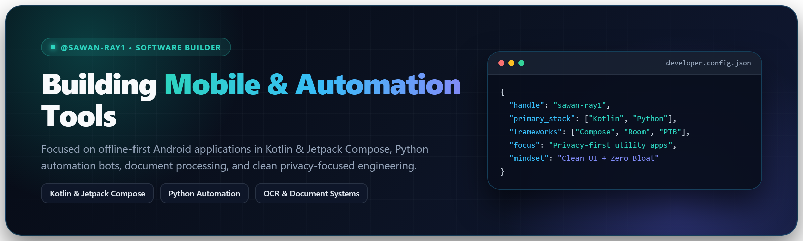

 

---

## 👋 About Me

Hi, I'm **Sawan Ray** (`@sawan-ray1`) — a developer focused on building **offline-first Android applications**, **Telegram document & OCR automation bots**, and **practical everyday utilities** with clean UX and strong privacy boundaries.

- 📱 **Mobile Engineering**: Native Android apps in **Kotlin**, **Jetpack Compose (Material 3)**, and **Room** with strict on-device storage.
- 🤖 **Automation & Bots**: Asynchronous **Python** services using `python-telegram-bot`, **Pillow**, **PyPDF**, and **Tesseract OCR**.
- 🔐 **Privacy-First Craft**: Designing tools that solve real workflows locally—without unnecessary permissions, telemetry, or credential sprawl.

---

## 🚀 Featured Projects

<table>
  <tr>
    <td width="50%" valign="top">
      <h3>💳 My Expense Tracker</h3>
      
<strong>Offline-First Indian Bank &amp; UPI SMS Expense Ledger</strong>

      <ul>
        <li>Parses bank/UPI debit SMS alerts on-device with zero <code>INTERNET</code> permission.</li>
        <li>Smart regex categorization, remembered merchant rules, and month-wise batch editing.</li>
        <li>Interactive Canvas donut charts, daily bar timelines, and 6-month spending comparisons.</li>
      </ul>
      
<code>Kotlin</code> • <code>Jetpack Compose</code> • <code>Material 3</code> • <code>Room 2.7</code>

    </td>
    <td width="50%" valign="top">
      <h3>🖼️ DocPix Studio Bot</h3>
      
<strong>All-in-One Telegram Document, OCR &amp; Exam-Prep Studio</strong>

      <ul>
        <li>Exact-KB binary-search compression (<code>20 KB</code>, <code>50 KB</code>) and <strong>300 DPI</strong> 8-in-1 passport sheets.</li>
        <li>Bilingual OCR (English + Hindi) via local Tesseract with automatic OCR.space fallback.</li>
        <li>Button-driven album/PDF batch merger with 1.3s debouncing, compression, and page splitting.</li>
      </ul>
      
<code>Python</code> • <code>python-telegram-bot</code> • <code>Pillow</code> • <code>PyPDF</code>

    </td>
  </tr>
</table>

---

## 🛠 Tech Stack & Ecosystem

| Domain | Technologies |
| :--- | :--- |
| **Languages** | Kotlin, Python, SQL |
| **Android & UI** | Jetpack Compose, Material 3, AndroidX Room, KSP, Lifecycle / Coroutines |
| **Automation & Docs** | `python-telegram-bot`, Pillow, PyPDF, Tesseract OCR, httpx |
| **Deployment & Tooling** | Gradle, Git, Render, Linux `systemd` (Oracle Cloud) |

---

  Focused on clean architecture, intuitive interfaces, and practical software • <b>@sawan-ray1</b>

